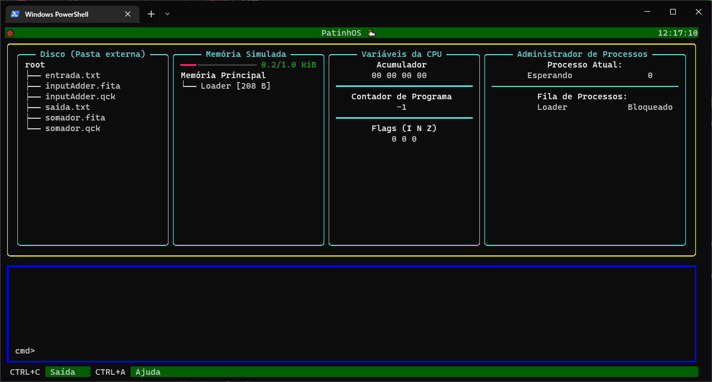

# PCS3446
Project for PCS3446 - Operating Systems (2022), an Electrical Engineering course at POLI-USP.

An application that simulates an operating system and its components.



# Installation

First, install the Textual library with
```
python3 -m pip install textual
```
Then, in the project folder, run
```
cd src
python3 main.py
```

# Detailed description

The application simulates an operating system running on a 32-bit accumulator-based processor, designed in the course PCS3216 - Programming Systems.

The application is called PatinhOS, after Patinho Feio, the first computer built at the university.


## Processor

The processor is based on a single general-purpose register, the accumulator. Instructions and data are 32 bits long: 5 bits of opcode and 27 bits of operand.

Multiprogrammed execution is possible, with the degree set in *./src/pyLib/configs.py*.

## Memory

The system has a main memory of configurable size, 1 KiB at first, partitioned with *First Fit* allocation and no *Garbage Collection*.

To change the memory size, open *./src/pyLib/configs.py* and change *memoryAddressBits*.

## Virtual disk

The application can only access the **./src/root/** folder, which is where the **.qck** and **.fita** files must be stored.
